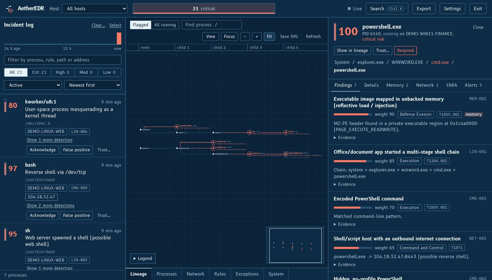
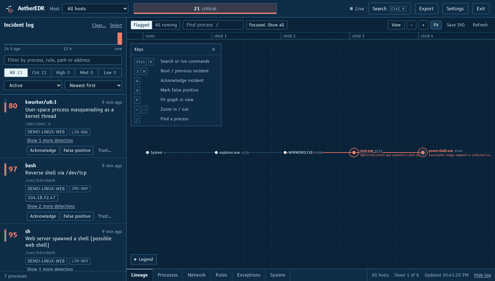
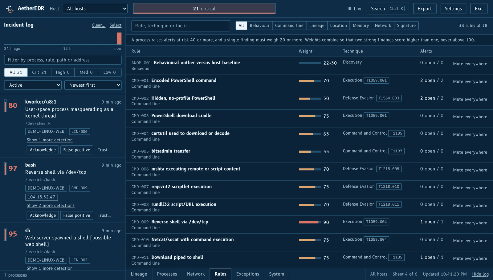

# AetherEDR

[](https://github.com/SparklyBird/AetherEDR/actions/workflows/ci.yml)

A standalone endpoint detection and response platform. One process runs the telemetry collector, the detection engine, the REST API, the embedded SQLite database and the web console. No Docker, no external database, no osquery, Sysmon or Falco.

```
AetherEDR.bat          # Windows: sets everything up, starts the collector, serves the console, opens your browser
```

On Linux and macOS, or to run it by hand, install the requirements first: see [Quick start](#quick-start). A plain `python run.py` only works after that.

Run it as **root / Administrator** for full memory visibility. Without elevation it only sees processes you own.

## Screenshots

Taken with the built-in demo data (`AetherEDR.bat demo`), so nothing here comes from a real machine.



*Incident log on the left, process lineage in the middle, and the findings behind one process on the right. Here a Word document starts cmd.exe, which starts PowerShell with code mapped in unbacked memory.*



*The lineage of one process, with the keys card at the top left.*



*Every rule with its weight, ATT&CK technique and how many alerts it raised. Rules can be muted from here.*

## Quick start

The console is pre-built in `frontend/dist`. Node is only needed to change the UI.

**Windows, one click:** double-click `AetherEDR.bat`. First run creates `.venv` and installs everything, then it asks for Administrator and starts the console.

| Command | Does |
| --- | --- |
| `AetherEDR.bat` | start (asks for Administrator) |
| `AetherEDR.bat selftest` | check this machine |
| `AetherEDR.bat demo` | load `DEMO-*` sample data, then start |
| `AetherEDR.bat reinstall` | reinstall dependencies |
| `AetherEDR.bat --no-admin` | skip the Administrator prompt |
| `AetherEDR.bat --port 9000` | anything else goes to `run.py` |

**Windows by hand (cmd.exe)** - open as Administrator for full memory visibility:

```bat
python -m venv .venv
.venv\Scripts\activate
pip install -r requirements.txt
python -m edr.selftest
python run.py
```

PowerShell: activate with `.venv\Scripts\Activate.ps1`.

**Linux / macOS**:

```bash
python3 -m venv .venv && . .venv/bin/activate
pip install -r requirements.txt
python -m edr.selftest
sudo -E .venv/bin/python run.py                      # root for full memory visibility
```

The console URL (with the API key in the fragment) is printed at startup. The key lives in `data/api_key`.

To reach the console from another machine, use HTTPS: `python run.py --host 0.0.0.0 --tls` (see [Encryption and keys](#encryption-and-keys)). Binding to a network address without `--tls` is refused.

Rebuild the UI (optional): `cd frontend && npm install && npm run build`.

### Optional: YARA memory scanning

Everything runs without it. YARA scans return 503 and the console says so.

```
pip install -r requirements-yara.txt
```

`yara-python` ships prebuilt Windows wheels for Python 3.9 to 3.13. On Python 3.14 pip builds from source and fails without the Microsoft C++ Build Tools. Use Python 3.12 or 3.13:

```bat
winget install Python.Python.3.13
py -3.13 -m venv .venv
.venv\Scripts\activate
pip install -r requirements.txt -r requirements-yara.txt
```

Try it on a quiet machine with synthetic telemetry, clearly labelled `DEMO-*`:

```bash
python manage.py seed_demo            # python manage.py seed_demo --purge removes it again
```

## What it does

| Area | Implementation |
| --- | --- |
| Process telemetry | `psutil` polling: creation, exit, parent/child lineage (PID reuse safe via create-time), command line, user, SHA-256 of the binary |
| Memory introspection | Linux: `/proc/<pid>/maps` + `/proc/<pid>/mem`. Windows: `VirtualQueryEx` / `ReadProcessMemory` / `GetMappedFileNameW` through `ctypes`. Flags RWX, unbacked executable, executable mappings from temp or deleted files, PE/ELF headers in private memory, region entropy |
| Network | Sockets mapped to PID and binary path; offline GeoIP/ASN; DGA-style hostname entropy (opt-in reverse DNS); beacon interval regularity |
| Detection | Pure-function rules (`edr/engine/rules.py`): lineage, masquerading, execution location, command-line patterns, memory, network. Risk = noisy-OR of finding weights, 0 to 100 |
| Baseline | Isolation Forest (scikit-learn) over per-process features, combined with an out-of-range term (see below) |
| YARA (optional) | `yara-python` scans live process memory regions and the binary on disk; custom rules accepted (`include` is disabled). Runs automatically on high-risk memory findings |
| Reports | Jinja2 narrative, then `python-docx` or ReportLab, generated locally |
| Console | React + Tailwind, styled as a reviewed engineering drawing (three themes). Live incident log (SSE), lineage drawing, process dossier (findings, memory map and hex, YARA, sockets), process and network tables, rule catalogue, exceptions, system health, response actions, report and CSV export |

## Using the console

Six sheets along the bottom (keys `1` to `6`). The incident log stays on the left, the process dossier opens on the right.

| Sheet | Does |
| --- | --- |
| Lineage | Process tree drawn as a schematic. Flagged processes get a redline revision cloud and an italic note. Fold, focus on one family, find by name, stack identical helpers, include exited processes, save as SVG. Zoom and position survive refreshes |
| Processes, Network | Sortable, filterable tables. Save either as CSV |
| Rules | Every detection with weight, MITRE tactic and technique, alert counts. Mute a rule everywhere or bring it back |
| Exceptions | Behaviours you decided to trust. Turn off or remove any of them and the alerts return |
| System | Collector health (cycles, failures, restarts), data folder, database size, stored history with a *Clear history...* button, settings in effect, API key, response action log |

**Keys card.** A small card at the top left of the lineage lists the main keys. Close it with the x and bring it back with the *Keys* button. The choice is remembered, and the graph leaves room for it while it is open. It is hidden on narrow screens.

**Exit.** *Exit* in the top bar (or Ctrl K, then Exit) asks first, then stops the collector, the console and the server, the same as Ctrl+C in the terminal. The page then says AetherEDR has stopped. It needs the operator key, so the agent key cannot do it, and the button only shows when `run.py` started the program. With `AetherEDR.bat` the terminal window closes by itself after Exit or Ctrl+C. After an error it stays open so the message can be read.

**Memory coverage.** The System sheet counts how many running processes could be read, and how many are protected or refused (no permission). Run elevated to cover other users' processes.

**Clearing history.** *Clear...* in the incident log header, *Clear history...* on the System sheet, or the command palette. Pick everything or only what is older than 1, 3, 7, 14, 30 or any number of days. The dialog counts what would go before you confirm. It removes processes that have exited (with their connections, memory scans and YARA jobs) and, optionally, the alerts that belong to nothing running. Running processes, exceptions and the response log are never touched, and an exited parent of a running process is kept so its lineage stays intact. Export first if you may need the records. Exited processes older than `AETHER_RETENTION_DAYS` are also removed automatically.

**Trusting a false positive.** Use *Trust...* on an incident or in the dossier. Pick how narrow it is: these detections for this program, for a process name, everything from one program, or a rule everywhere. Matching findings stop counting toward the risk score, matching alerts close and are marked *muted by exception*. Nothing is deleted.

**Response actions.** *Respond* in the dossier suspends, resumes or terminates a process on the machine running AetherEDR. Every action is confirmed and written to the action log. The system, AetherEDR itself and its parents are refused.

**Exports.** Report as PDF or Word, alerts as CSV or JSON, tables as CSV, lineage as SVG. Export menu in the top bar, or Ctrl K.

**Flagged-process export** (Export, then Processes). Every process at or above the alert threshold, with rule IDs, weights, evidence, lineage, memory summary, flagged regions, recent sockets, YARA hits and silenced findings. JSON is complete and carries a per-rule summary; CSV has one row per finding for spreadsheets. Use it for tuning: it shows which rules and weights produced each score. Command lines are copied verbatim, so review before sharing.

**Settings** (top bar): Cyanotype, Graphite or Vellum theme, density, text size, animation, line style, label mode, risk filter, refresh pace, desktop notifications, open-alert count in the tab title.

| Key | Does |
| --- | --- |
| `Ctrl K` | Search processes, run any command |
| `1` to `6` | Switch sheet |
| `j` `k`, `a`, `x` | Next or previous incident, acknowledge, false positive |
| `f`, `+` `-`, arrows, `c`, `/` | Lineage: fit, zoom, walk the tree, fold, find |
| `t`, `l`, `,`, `Esc` | Theme, hide log, settings, close dossier |

**When something fails.** The console keeps the last data it received and says so, shows a plain-language message with *Try again* instead of a blank panel, rolls back an alert change the server rejected, and isolates a crashing panel so the rest keeps working. The collector counts cycles and failures, and a supervisor restarts it if it dies (System sheet).

## Layout

```
aether/            Django project, settings (SQLite WAL), launcher
edr/
  collector/       collector.py, memory.py, _linux.py, _windows.py, agent.py
  engine/          rules.py, anomaly.py, netintel.py, yara_scanner.py, pipeline.py, jobs.py, maintenance.py
  reporting/       builder.py + Jinja2 templates
  yara_rules/      built-in signatures
  models.py views.py serializers.py auth.py urls.py tests.py selftest.py
frontend/          React + Tailwind (Vite). Fonts are bundled, nothing loads from a CDN
aetheredr.spec     PyInstaller recipe        scripts/build_exe.py
```

## API

All endpoints except `/api/health/` need `X-Aether-Key: <key>` (or `Authorization: Bearer`).

| Endpoint | Purpose |
| --- | --- |
| `POST /api/ingest/` | Collector batches (also used by remote agents) |
| `GET /api/overview/` | Counters, 24 h timeline, top processes, collector status |
| `GET /api/alerts/` `PATCH /api/alerts/{id}/` | Filters: `status`, `severity`, `host`, `search`, `since_id`, `min_score` |
| `GET /api/alerts/stream/` | Server-sent events: `alert`, `stats`, heartbeats |
| `GET /api/processes/` `/{id}/` | Filters: `host`, `search`, `min_score`, `alive`, `pid`, `ordering` |
| `GET /api/processes/{id}/memory/` `/memory/map/` `/memory/read/` | Stored scan, live address-space map, hex bytes (executable regions only, 64 KB cap) |
| `POST /api/processes/{id}/yara-scan/` | Queue a scan. Poll `GET /api/yara/{job}/` |
| `GET /api/graph/` | Lineage nodes. `focus=<id>` for one process's tree, `all=1` for everything running |
| `POST /api/processes/{id}/respond/` | `{"action": "suspend" \| "resume" \| "terminate"}`. Local host only, audited |
| `GET /api/connections/` `/api/hosts/` | Network and host views |
| `GET /api/alerts/export/?type=csv\|json` | Same filters as the alert list, plus `hours` |
| `GET /api/processes/export/?type=json\|csv` | Flagged processes with findings and evidence. Defaults to risk at or above the alert threshold; `min_score`, `alive`, `host`, `search` filter. Capped at 5000 |
| `GET POST /api/exceptions/` `PATCH DELETE /{id}/` | Trust rules. Fields: `rule_id` (exact, or prefix ending `*`), `exe`, `name`, `note`, `enabled` |
| `GET /api/rules/` | Rule catalogue with weights, techniques, alert counts, muted state |
| `GET /api/system/` `/api/actions/` | Collector health and settings, response action log |
| `POST /api/system/shutdown/` | Body `{"confirm": true}`. Stops AetherEDR after the reply is sent. Operator key only. Answers 409 when `run.py` did not start it, so there is nothing to stop |
| `POST /api/maintenance/clear/` | Body `{"older_than_days": 7 or null, "alerts": true, "host": id, "dry_run": true}`. A dry run only counts. A real run needs `"confirm": true`. Returns the counts removed |
| `GET /api/reports/export/?type=pdf\|docx&hours=24` | Executive report |

## Configuration (environment variables)

| Variable | Default | |
| --- | --- | --- |
| `AETHER_DATA_DIR` | `./data` (next to the binary when frozen) | DB, API key, secret key, optional `geo_asn.csv` |
| `AETHER_INTERVAL` | `5` | Collector poll seconds |
| `AETHER_ALERT_THRESHOLD` | `40` | Minimum process risk to raise alerts |
| `AETHER_JIT_ALLOW` | | Extra process names where RWX memory is expected (comma-separated) |
| `AETHER_SHARED_REGION_MIN` | `8` | Executable regions with identical content in this many differently named programs (at least 3 names) on one host are treated as a system-wide component and score low. Still listed, never hides a PE header. `0` turns it off |
| `AETHER_WATCH_COUNTRIES` / `AETHER_WATCH_ASNS` | | Flag outbound connections to these (policy rule) |
| `AETHER_REVERSE_DNS` | `0` | `1` enables rDNS for hostname entropy. This emits DNS queries |
| `AETHER_EVENTS` | `1` | OS notifications for new processes, so ones shorter than a poll are recorded. `0` is polling only |
| `AETHER_API_KEY` / `AETHER_INGEST_KEY` | generated in `data/` | Fix the keys instead of generating them |
| `AETHER_RETENTION_DAYS` | `14` | Exited processes and closed alerts older than this are removed automatically. Use *Clear history* for anything sooner |

**GeoIP/ASN:** the built-in table is a tiny seed (public DNS resolvers and Cloudflare). For real coverage drop a dataset at `data/geo_asn.csv`. Supported layouts: iptoasn.com TSV (`start end asn country description`), `cidr,country,asn,org`, or `start_ip,end_ip,country`.

## Multi-host

```bash
python run.py --no-agent --host 0.0.0.0 --tls                                       # server, encrypted
python run.py --agent-only --server https://SERVER:8787 --key <AGENT_KEY> --ca-cert server.crt   # each endpoint
```

Live memory views and YARA scans only work for processes on the machine that runs the server. Remote agents ship telemetry and memory summaries, not memory.

## Encryption and keys

Two keys are created in the data folder on first run:

* `api_key` is the console and scripts. Full access.
* `ingest_key` is for remote agents. It can only send data to `/api/ingest/`. A stolen agent key cannot read alerts or memory, run response actions or clear history. The System sheet shows both.

HTTPS is built in and needs nothing extra:

| Flag | Does |
| --- | --- |
| `--tls` | serve HTTPS with a self-signed certificate made on first use (`data/tls/server.crt`, `server.key`). It is renewed when the names change or it is within 30 days of expiry |
| `--tls-cert FILE --tls-key FILE` | use your own certificate instead (a real CA, or an internal one) |
| `--tls-name NAME` | extra DNS name or IP the certificate and the allowed Host header should cover. Repeatable |
| `--ca-cert FILE` | agent side: trust this one certificate (the server's `server.crt`). Without it an agent rejects a self-signed server |
| `--allow-plain-http` | allow a network address without TLS, for a closed lab only |

Your browser warns once about a self-signed certificate because nobody else vouches for it. Compare the fingerprint, or import `server.crt`, or bring your own certificate. Agents never skip verification: they either trust the file you give them or refuse to send.

Design: waitress only speaks plain HTTP, so a small standard-library TLS front listens on the network address and hands the decrypted bytes to waitress, which stays on a private port of 127.0.0.1. The certificate is generated by `aether/tlsgen.py` (RSA-2048, SHA-256, with the usual server extensions), because the standard library cannot create certificates and a dependency would break the zero-dependency rule. It is for a certificate you generate once for your own machine.

## Packaging

```bash
python scripts/build_exe.py        # npm build (if needed) + PyInstaller -> dist/AetherEDR/
```

Output is a self-contained folder. Build on each target OS; PyInstaller does not cross-compile.

## Detection logic worth knowing

* **Noisy-OR scoring.** Two 85-weight findings give 98, not 170. One weak finding stays weak.
* **Anomaly is supporting evidence.** Its weight is 22 to 30, so an outlier score alone never reaches the alert threshold. Large, busy programs (browsers, games) are outliers by nature. It still adds to the score when a memory, network or lineage rule also fires.
* **Uncommon-port alerts are one per process.** The finding lists the destinations and updates in place, instead of raising an alert for every new peer. Eight or more public peers on five or more ports is the shape of a peer-to-peer swarm and scores low (8, below the alert minimum). One port on many hosts, or a few fixed destinations, keeps full weight.
* **Baseline, two terms.** Isolation Forest cannot isolate a value on a feature that was constant in training (a fleet with zero RWX regions makes the first RWX region invisible to it). The engine therefore also scores how far each feature exceeds its training 99.5th percentile and uses the larger of the two.
* **New processes are announced, not only polled.** Linux uses the netlink process connector, Windows uses a WMI start-trace watcher. The collector reads each announced process immediately, so a process that lives for 50 ms still gets a record with its path, command line and parent, and a start and exit time. In a test of 60 short processes (50 ms and 1 ms lifetimes) polling alone recorded 1 and notifications recorded 57. The System sheet shows which source is active and how many were gone before they could be read.
* **Restart reconciliation.** On start the collector lists every live process and the server closes any it still had as running that is not on the list. Processes that exited while the app was closed get the last time the collector was seen as their end time.
* **One alert per process per rule**, deduplicated, never reopened once an analyst closes it. The timeline groups them per process.
* **Runtime-aware memory rules.** Executable memory is normal in processes that load a JIT or an embedded browser engine (.NET, Java, Chromium, Qt QML, Mozilla and similar). AetherEDR detects those modules in the process and down-weights the memory findings. There is also a name allow-list for common JIT hosts, matched on process and executable name. A PE or ELF header in private executable memory still scores 90 on any process.
* **Exceptions beat tuning.** For anything else that is legitimate on your machines, use *Trust...* instead of lowering weights.

## Limitations

* **Short-lived network connections are still polled.** Process starts are announced by the OS, sockets are not. A connection that opens and closes between two polls is missed, and a process that exited before it could be read has no connection record. Lower `AETHER_INTERVAL` to narrow it. Notifications need root on Linux and Administrator on Windows, otherwise the System sheet says "polling only" and why.
* **Windows-only code has had less testing.** CI runs the unit tests and the live self-test on Windows and Ubuntu with Python 3.10 and 3.13 (`.github/workflows/ci.yml`). The Windows-only parts (`VirtualQueryEx`, the protected-process query, the WMI watcher) were written on Linux, so the self-test and CI are how they get proven on a real Windows host. Run `AetherEDR.bat selftest` on your own PC first. The Linux path and the shared logic are tested directly, including on Python 3.10.
* **Protected processes cannot be read by any user-mode program.** `lsass` with RunAsPPL, `csrss`, `System` and similar refuse memory reads even for Administrator, by design. AetherEDR cannot change that without a kernel driver. It does not hide the gap: those processes are classified as protected, counted under *Memory coverage* on the System sheet, marked in the process dossier ("no memory finding does not mean clean"), and their start, parent, command line and connections are still recorded.
* **Heuristics.** Weights are starting points. Expect false positives from security tools, game anti-cheat, packers and developer tooling. Tune `JIT_ALLOW` and the rule weights. Memory findings for a region that appears identically in many programs on the host (an OS component, overlay or security hook) are downweighted by content, not by vendor name. There is deliberately no vendor allow-list: a trusted product can be replaced or abused later. Silence a known-good case with a narrow exception (Trust), which is audited and reversible.
* **Unsupervised baseline learns what is already there.** A host that is compromised during training treats the attacker as normal.
* **Response is minimal.** Suspend, resume and terminate on the local machine only. There is no network isolation, quarantine or remote response.
* **The built-in certificate is self-signed.** That is encrypted and agents can pin it, but a browser cannot know it is yours until you import it. For anything beyond a lab bring a certificate from your own CA (`--tls-cert`).

## License

[PolyForm Noncommercial 1.0.0](LICENSE). You can read, run, change and share this code for any noncommercial purpose: personal use, study, research, hobby projects, and use by schools, charities and public bodies. Commercial use is not allowed. That includes using it inside a company for business work, selling it, or offering it as a service. This is source-available software, not open source in the OSI sense. For commercial use, contact the author through [github.com/SparklyBird](https://github.com/SparklyBird) for a separate license.

The dependencies keep their own licenses (Django, psutil, scikit-learn, React and others, all permissive). The bundled B612 and IBM Plex Mono fonts are under the SIL Open Font License. Details and license texts are in [THIRD_PARTY_NOTICES.md](THIRD_PARTY_NOTICES.md).
